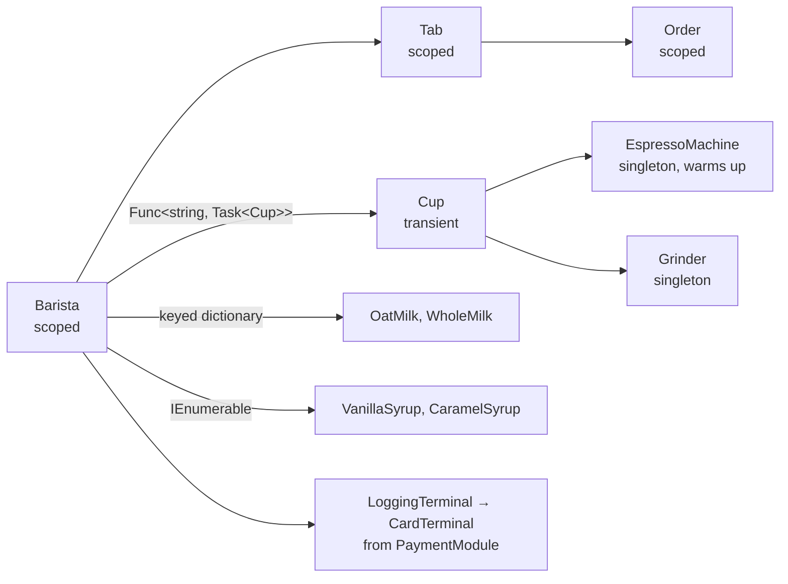

# Complete example

This page assembles a full coffee shop from the pieces in the rest of the docs. It shows a realistic container: [async equipment](../04-core-concepts/03-async-initialization.md), [per-order scopes](../04-core-concepts/02-scopes.md), cups sized at [run time](../06-resolution/06-runtime-arguments.md), [keyed milk](../05-registration/05-keyed-services.md), a [collection](../06-resolution/03-collections.md) of syrups, and a [decorated](../05-registration/03-decorators.md) payment terminal from a [module](../05-registration/08-modules/index.md). Read it top to bottom for an overview of how the features fit together, and follow the links for the details.



## The services

The services are plain classes. None of them references Awaiten.

```csharp title="Services.cs"
public interface IWarmUp
{
    Task WarmUpAsync(CancellationToken cancellationToken);
}

public sealed class EspressoMachine : IWarmUp
{
    public bool IsHot { get; private set; }

    public async Task WarmUpAsync(CancellationToken cancellationToken)
    {
        await Task.Delay(TimeSpan.FromMilliseconds(100), cancellationToken);   // stands in for heating the boiler
        IsHot = true;
    }

    public string PullShot(Grinder grinder)
        => IsHot ? $"an espresso from {grinder.Grind()}" : throw new InvalidOperationException("The boiler is cold.");
}

public sealed class Grinder
{
    public string Grind() => "fresh grounds";
}

public sealed class MenuBoard
{
    public string Special { get; init; } = "";

    public static MenuBoard Load() => new() { Special = "Hazelnut latte" };
}

public sealed class Order
{
    public List<string> Items { get; } = [];
}

public sealed class Tab(Order order) : IDisposable
{
    public void Add(string item) => order.Items.Add(item);

    public void Dispose() => Console.WriteLine($"Tab closed with {order.Items.Count} item(s).");
}

public sealed class Cup(string size, string coffee)
{
    public string Size => size;
    public string Coffee => coffee;
}

public interface IMilk { string Name { get; } }
public sealed class OatMilk : IMilk { public string Name => "oat"; }
public sealed class WholeMilk : IMilk { public string Name => "whole"; }

public interface ISyrup { string Name { get; } }
public sealed class VanillaSyrup : ISyrup { public string Name => "vanilla"; }
public sealed class CaramelSyrup : ISyrup { public string Name => "caramel"; }

public interface IPaymentTerminal { Task ChargeAsync(decimal amount); }

public sealed class CardTerminal : IPaymentTerminal
{
    public Task ChargeAsync(decimal amount) => Task.CompletedTask;
}

public sealed class LoggingTerminal(IPaymentTerminal inner) : IPaymentTerminal
{
    public Task ChargeAsync(decimal amount)
    {
        Console.WriteLine("Charging the card.");
        return inner.ChargeAsync(amount);
    }
}

public sealed class Barista(
    Tab tab,
    Func<string, Task<Cup>> cups,
    IReadOnlyDictionary<string, IMilk> milks,
    IEnumerable<ISyrup> syrups,
    IPaymentTerminal terminal)
{
    public async Task<string> ServeAsync(string size, string milk)
    {
        Cup cup = await cups(size);
        string syrup = string.Join(" and ", syrups.Select(s => s.Name));
        string drink = $"a {cup.Size} {milks[milk].Name} latte with {syrup} syrup, made with {cup.Coffee}";

        await terminal.ChargeAsync(4.50m);
        tab.Add(drink);
        return drink;
    }
}
```

## The payment module

Group the payment wiring so it can be reused and tested on its own. The module registers the terminal and wraps it with logging.

```csharp title="PaymentModule.cs"
using Awaiten;

[Module]
[Singleton<CardTerminal, IPaymentTerminal>]
[Decorate<LoggingTerminal, IPaymentTerminal>]
public static partial class PaymentModule;
```

## The container

```csharp title="CoffeeShop.cs"
using Awaiten;

[Container]
[AsyncInitializer<IWarmUp>(nameof(IWarmUp.WarmUpAsync))]
[Import(typeof(PaymentModule))]

// equipment
[Singleton<EspressoMachine>]
[Singleton<Grinder>]
[Singleton<MenuBoard>(Instance = nameof(Menu))]

// per order
[Scoped<Order>]
[Scoped<Tab>]
[Scoped<Barista>]

// made to order, sized at request time
[Transient<Cup>(Factory = nameof(MakeCup))]

// keyed milk
[Singleton<OatMilk, IMilk>(Key = "Oat")]
[Singleton<WholeMilk, IMilk>(Key = "Whole")]

// syrups as a set
[Singleton<VanillaSyrup, ISyrup>]
[Singleton<CaramelSyrup, ISyrup>]
public static partial class CoffeeShop
{
    private static MenuBoard Menu { get; } = MenuBoard.Load();

    private static Cup MakeCup(EspressoMachine machine, Grinder grinder, [Arg] string size)
        => new(size, machine.PullShot(grinder));
}
```

- The `[AsyncInitializer<IWarmUp>]` convention makes every `IWarmUp` of the shop [async](../04-core-concepts/03-async-initialization.md#mark-a-service-as-async), so the `EspressoMachine` is warmed up before anything receives it. A `Cup` needs the machine, so it is async too.
- The `Barista` takes its cups through `Func<string, Task<Cup>>`. The size is a [runtime argument](../06-resolution/06-runtime-arguments.md#keep-the-argument-off-the-domain-type-with-a-factory) of the `MakeCup` factory, and the `Task` [defers the async work](../04-core-concepts/03-async-initialization.md#keep-a-consumer-synchronous-by-deferring-the-async-work), so the `Barista` itself resolves synchronously.
- The milk is picked by key at run time from a [keyed dictionary](../06-resolution/04-keyed-dictionaries.md), and the syrups arrive as a [collection](../06-resolution/03-collections.md) in declaration order.
- The `MenuBoard` is a pre-built [instance](../05-registration/01-factories-and-instances.md#instance). The container hands it out and never disposes it.

## Opening the shop and serving an order

Create the root, warm the equipment once at startup, then serve each order in its own scope.

```csharp title="Program.cs"
using Awaiten;

await using CoffeeShop.Root shop = new();
await shop.InitializeAsync();   // the espresso machine heats its boiler, once

Console.WriteLine($"Today's special: {shop.Resolve<MenuBoard>().Special}");

await using (IAwaitenScope order = shop.CreateScope())
{
    Barista barista = order.Resolve<Barista>();
    string drink = await barista.ServeAsync("large", "Oat");
    Console.WriteLine($"Served {drink}.");
} // the scope disposes the order's Tab here
```

```text title="Output"
Today's special: Hazelnut latte
Charging the card.
Served a large oat latte with vanilla and caramel syrup, made with an espresso from fresh grounds.
Tab closed with 1 item(s).
```

The `Order`, `Tab` and `Barista` belong to the scope. Disposing the scope disposes the `Tab`, the one disposable among them. Disposing the root at the end disposes the singletons it built, in reverse creation order, and leaves the `MenuBoard` alone.

## What the compiler checked

None of this wiring is trusted at run time. Before the app ran, Awaiten verified that every dependency is registered, that no singleton captures a scoped service, that the decorated terminal has something to decorate, that the `Cup`'s runtime argument matches the `Func` that supplies it, and that nothing reaches the async machine through a synchronous path. A mistake in any of those would have failed the build. Try it: change the `Barista` to take `Func<string, Cup>`, and the build stops with [AWT120](../09-diagnostics.md#awt120).

## Where to go next

- [What Awaiten generates](./01-generated-code.md) to see the code the generator writes for this container.
- [Lifetimes](../04-core-concepts/01-lifetimes.md) to start on the concepts behind it.
- [Diagnostics](../09-diagnostics.md) for every check the compiler runs.
- [MS.DI bridge](../07-hosting/01-msdi-bridge.md) to run this under ASP.NET Core.
