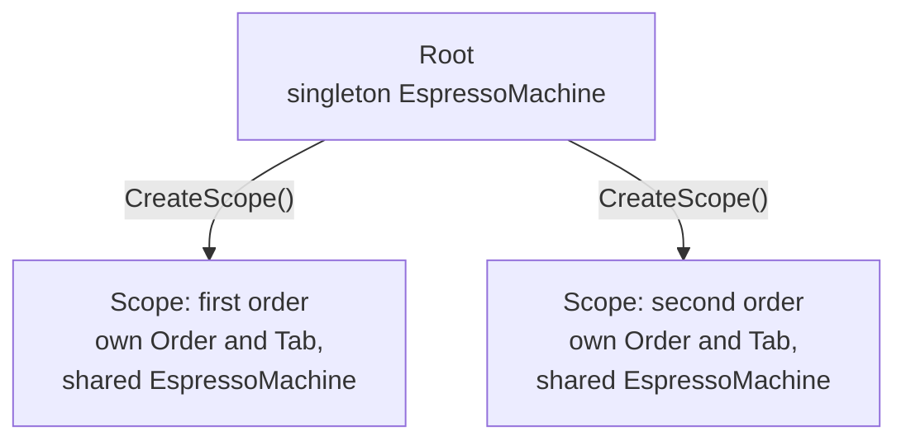

# Scopes

A scope is a boundary for scoped services. Everything scoped is created once inside it and disposed when it closes. In the shop, each order is a scope. The tab and the order state belong to that order and go away when it is done.

## Open a scope

Call `CreateScope` on the root or on another scope. Dispose it when the unit of work is over.

```csharp
using CoffeeShop.Root shop = new();

using (IAwaitenScope order = shop.CreateScope())
{
    Order o = order.Resolve<Order>();
    Tab tab = order.Resolve<Tab>();
} // the order, the tab, and any disposable transient resolved here are disposed
```

## Singletons are shared, scopes are not

A child scope shares the container's singletons. It has its own scoped instances: inside one scope a scoped service resolves to the same instance every time, and a different scope gets its own (see [Scoped](./01-lifetimes.md#scoped)). Disposing a child does not touch the parent, and the espresso machine keeps running across every order.



## The root is the outermost scope

The `Root` is itself a scope. A scoped service resolved directly on the root behaves like a singleton, because the root lives as long as the container.

## Async scopes

If a scope has async-initialized scoped services, open it with `CreateScopeAsync`. Before it hands the scope back, it builds and initializes every one of them in dependency order, so they are ready on the first resolve. Plain scoped services are still created lazily on first use. See [Warm a scope](./03-async-initialization.md#warm-a-scope) for what happens when an initialization fails.

```csharp
await using IAwaitenScope order = await shop.CreateScopeAsync(cancellationToken);
```

## Where to go next

- [Disposal](./05-disposal.md) for the teardown rules.
- [Lifetimes](./01-lifetimes.md) for the difference between the three lifetimes.
