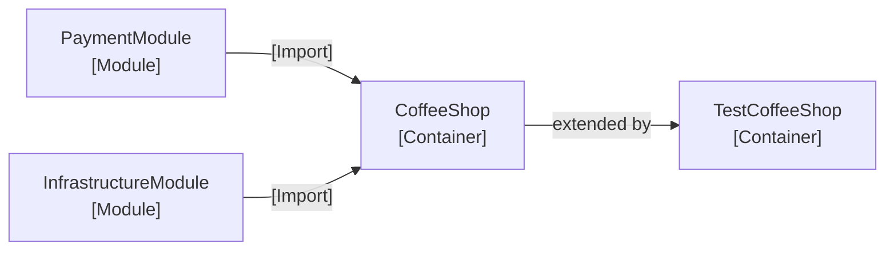

# Modules

A module is a reusable bundle of registrations. It lets you group everything for payments, or for the seasonal menu, and drop it into a container with one line. Modules can live in other assemblies, so a shared library can ship its own wiring.



The container is the one place that composes modules. A [test container](../08-extending-containers.md) can extend it and replace what a test needs to control.

## Declare a module

A module is a `static partial` class marked `[Module]`. It carries the same registration attributes a container does.

```csharp
[Module]
[Singleton<CardTerminal, IPaymentTerminal>]
[Singleton<ReceiptPrinter, IReceiptPrinter>]
public static partial class PaymentModule;
```

`partial` is optional while every type the module registers is public, but declare it anyway: as soon as a library keeps an implementation `internal`, the generator has to add a factory to the module (see [shipping modules from a library](./01-library-modules.md)).

## Import it

Pull a module into a container with `[Import]`.

```csharp
[Container]
// highlight-next-line
[Import(typeof(PaymentModule))]
[Singleton<EspressoMachine>]
public static partial class CoffeeShop;
```

Everything the module registers is now part of the container. Import several modules with one `[Import]` each.

## Overridable defaults

A module can offer a default that the container is free to replace. Set `Fallback` on the registration:

| `Fallback` | Meaning |
|---|---|
| not set | A normal registration. It replaces every default of the same service. |
| `Fallback.Warn` | An overridable default. When another overridable default competes with it, Awaiten reports [AWT148](../../09-diagnostics.md#awt148). |
| `Fallback.Silent` | The same kind of default, which stays quiet when another overridable default competes with it. |

```csharp
[Module]
[Singleton<RealTimeSystem, ITimeSystem>(Fallback = Fallback.Warn)]
public static class InfrastructureModule;

[Container]
[Import(typeof(InfrastructureModule))]
// highlight-next-line
[Singleton<MockTimeSystem, ITimeSystem>]   // wins over the module default
public static partial class CoffeeShop;
```

- If the container, or another module, registers the same service without `Fallback`, that registration wins and the default is dropped entirely, even from collections.
- Two kinds of registration without `Fallback` don't replace a default: a [scan](../06-scanning.md) match, and the closing of an [open generic](../05-open-generics.md) registration for a closed default. Both stay members of the collections, behind the default, which keeps single resolution.
- Defaults never replace each other. When several defaults provide the same service and no registration without `Fallback` does, each of them is a member of the service's collections, and the first one wins single resolution: the container's own registrations come first, then the imported modules in the order of their `[Import]`.
- A default that stays a member is built and checked like any other registration, also when it never wins single resolution. A missing or captive dependency of it is a compile-time error ([AWT101](../../09-diagnostics.md#awt101), [AWT105](../../09-diagnostics.md#awt105)), an eager one is built at startup, and its hooks and disposal apply. Only a default that a registration without `Fallback` replaces is left out entirely.
- The choice between `Warn` and `Silent` belongs to the module author on purpose: it sets the collision severity per registration, which a consumer's `.editorconfig` cannot do, because a diagnostic severity there applies to whole files, not to one registration.

An [open generic](../05-open-generics.md#overridable-defaults) default works the same way, per closing. The container can replace a single closing with a closed registration, or every closing with its own open registration:

```csharp
[Module]
[Singleton(typeof(MemoryCache<>), typeof(ICache<>), Fallback = Fallback.Warn)]
public static class CachingModule;

[Container]
[Import(typeof(CachingModule))]
[Singleton<OrderCache, ICache<Order>>]   // ICache<Order> is OrderCache, every other closing MemoryCache<T>
public static partial class CoffeeShop;
```

## Contribute to a collection

Several modules can each register their own implementation of a shared service, like plug-ins. A consumer that takes a collection of the service gets every contribution, in the order of the imports.

```csharp
[Module]
[Singleton<VanillaSyrup, ISyrup>]
public static class VanillaModule;

[Module]
[Singleton<CaramelSyrup, ISyrup>]
public static class CaramelModule;

[Container]
[Import(typeof(VanillaModule))]
[Import(typeof(CaramelModule))]
[Transient<SyrupBar>]
public static partial class CoffeeShop;

public sealed class SyrupBar(IEnumerable<ISyrup> syrups);   // VanillaSyrup and CaramelSyrup
```

- There is no need for `Fallback` here. A default is meant to be replaced: it stays in the collection only as long as no registration of the service without `Fallback` replaces it, so one such registration in another module would drop every default from it.
- A single `ISyrup` still resolves to one contribution, the one from the earlier import, as in Microsoft.Extensions.DependencyInjection a single service resolves to one registration.
- Because neither module shows which one that is, a dependency in the graph on a single `ISyrup` is reported ([AWT155](../../09-diagnostics.md#awt155)), and so is a `Resolve<ISyrup>()` on the generated `Root` or `Scope`. A collection, a [keyed dictionary](../../06-resolution/04-keyed-dictionaries.md) or a [composite](../03-composites.md) receives every contribution and is never reported.

## Factories and instances in modules

A module can use `Factory` and `Instance` too. Awaiten calls the members qualified by the module type, so this works across assemblies.

```csharp
[Module]
[Singleton<MemoryCache, ICache>(Instance = nameof(Cache))]
public static class ProductionModule
{
    public static MemoryCache Cache { get; } = new();
}
```

- A container registration of the same service, its own `Factory` or `Instance` included, wins over the module's, which stays a member of the collection (see [several producers of one service](../01-factories-and-instances.md#several-producers-of-one-service)).
- A member doesn't have to be public. What an `internal` or `private` member needs, and what a container in another assembly does with it, is described in [non-public members](./01-library-modules.md#non-public-members).

## One level deep

Imports are not transitive. Importing a module that declares an `[Import]` of its own is a build error ([AWT150](../../09-diagnostics.md#awt150)): import the nested module on the container directly. The container stays the single place that composes modules.

A module's own `[Scan]`, by contrast, does reach the importing container. A container expands it directly for a module in its own assembly, and a module in another assembly compiles it in its own build (see [self-compiled scans](./01-library-modules.md#self-compiled-scans)).

## Diagnostics

- Importing a type that is not a `[Module]` is an error ([AWT149](../../09-diagnostics.md#awt149)).
- A module must be static ([AWT152](../../09-diagnostics.md#awt152)).
- An imported module with an `[Import]` of its own is an error ([AWT150](../../09-diagnostics.md#awt150)).
- Two overridable defaults with `Fallback.Warn` for one service are reported ([AWT148](../../09-diagnostics.md#awt148)).
- A single dependency on a service that several modules contribute is reported ([AWT155](../../09-diagnostics.md#awt155)).

## Where to go next

- [Shipping modules from a library](./01-library-modules.md) to keep a library's implementations `internal` and still let any container import its module.
- [Scanning](../06-scanning.md) to register by convention instead of by hand.
- [Extending containers](../08-extending-containers.md) to reuse a whole container in tests and replace any inherited registration, not only a `Fallback` default.
- [Complete example](../../02-complete-example/index.md) to see modules in a full container.
